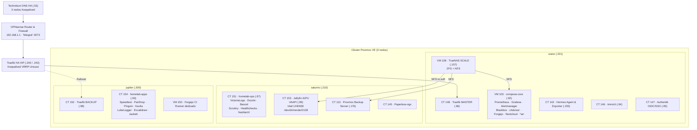

# Homelab Infrastructure as Code (Proxmox VE + Docker + Traefik HA + Observabilidad)

[](https://github.com/rrmoldes87/homelab-iac/actions/workflows/iac-guard.yml)

Repositorio público y sanitizado con la infraestructura declarativa, stacks Docker Compose, observabilidad, alta disponibilidad, backups y automatizaciones SRE de un homelab sobre **Proxmox VE (3 nodos)**.

> **Seguridad:** Este repositorio **no contiene secretos, claves API, contraseñas ni datos personales**. Todos los valores sensibles o específicos del entorno están sustituidos por marcadores descriptivos del tipo `<TU_DOMINIO>`, `<API_KEY_...>`, `<PASSWORD_...>` y validados automáticamente mediante [`tools/validate_iac.py`](tools/validate_iac.py) y GitHub Actions.

---

## Arquitectura General



---

## Estructura del Repositorio

| Carpeta | Contenido |
| :--- | :--- |
| [`compose/`](compose/) | Stacks Docker Compose de `VM 103`, `CT 151` (`homelab-ops`), `CT 153` (`jellyfin-saturno`), `CT 154` (`homelab-apps`) y `renovate`. |
| [`infra/traefik-ha/`](infra/traefik-ha/) | Alta disponibilidad Traefik (`CT 148` MASTER + `CT 152` BACKUP), Keepalived VRRP unicast, sincronización de rutas/certificados TLS y hardening de middlewares. |
| [`infra/prometheus-vm103/`](infra/prometheus-vm103/) | `prometheus.yml` (24 targets), Blackbox Exporter (HTTP/TLS/DNS), reglas SRE, Alertmanager (Telegram + ntfy), 5 dashboards JSON IaC en Grafana y datasource VictoriaLogs. |
| [`infra/logging-and-smart/`](infra/logging-and-smart/) | Recolección centralizada de logs con Vector (`CT`/`VM`) y `journald` (PVE) hacia VictoriaLogs + colectores SMART NVMe para Scrutiny. |
| [`infra/maintenance/`](infra/maintenance/) | Rotación de logs Docker (`daemon.json`), `docker-prune` semanal, auto-auditoría semanal SRE (`homelab-weekly-audit.py`) y plantillas de pings *dead-man's switch* para Healthchecks. |
| [`infra/authentik-oidc/`](infra/authentik-oidc/) | Automatización de proveedores OIDC nativos en Authentik (`Grafana`, `OpenWebUI`, `Immich`, `Forgejo`, `Paperless`, `Audiobookshelf`). |
| [`infra/hermes-ct142/`](infra/hermes-ct142/) | Hardening systemd, remediador autónomo con guardia NFS/TrueNAS (`alert_only`) y servidor MCP read-only. |
| [`infra/proxmox-backup/`](infra/proxmox-backup/) y [`infra/proxmox-startup-order/`](infra/proxmox-startup-order/) | Política declarativa de jobs PBS (retención `keep-last=3` local + diario PBS) y orden de arranque de invitados (`order=1..4`). |
| [`monitoring/stack/`](monitoring/stack/) | Exportador agregado Prometheus (`exporter.py`) y sondas de salud nativas (`native_health.py`). |
| [`tools/`](tools/) | Validador sintáctico + escáner de secretos (`validate_iac.py`) y hook local `pre-commit`. |

---

## Guía de Placeholders y Secretos (`<...>`)

Antes de desplegar cualquier archivo en tu entorno, sustituye los marcadores `<...>` o copia cada archivo `.tmpl` a su ruta de runtime con permisos `0600` (nunca los subas a Git):

| Marcador | Qué debes introducir | Archivos donde aparece |
| :--- | :--- | :--- |
| `<TU_DOMINIO>` | Tu dominio raíz (ej. `midominio.com`) | `compose/`, `infra/prometheus-vm103/`, `infra/gatus-vm103/`, `infra/traefik-ha/` |
| `<TU_EMAIL_ADMIN>` | Tu correo de administrador para cuentas iniciales | `compose/homelab-ops/healthchecks.env.tmpl` |
| `<TU_EMAIL_LETSENCRYPT_ACME>` | Tu correo para certificados ACME / Let's Encrypt | `infra/traefik-ha/ct148-static.json` |
| `<TU_USUARIO>` / `<TU_USUARIO_GIT>` | Tu usuario Linux / usuario de Git | `infra/`, `systemd/`, `monitoring/` |
| `<SECRET_KEY_DJANGO_32_BYTES_HEX>` | Clave aleatoria generada con `openssl rand -hex 32` | `compose/homelab-ops/healthchecks.env.tmpl` |
| `<APP_KEY_32_BYTES_BASE64>` | Clave Laravel generada con `openssl rand -base64 32` | `compose/homelab-apps/speedtest.env.tmpl` |
| `<PASSWORD_VRRP_KEEPALIVED_MAX_8_CHARS>` | Contraseña VRRP compartida entre nodos Keepalived (máx. 8 caracteres) | `infra/traefik-ha/keepalived-ct148.conf.tmpl`, `keepalived-ct152.conf.tmpl` |
| `<CLAVE_PUBLICA_HUB_BESZEL>` | Clave pública SSH generada por la UI de Beszel Hub al añadir un sistema | `compose/homelab-ops/beszel-agent.compose.yaml` |
| `<TELEGRAM_BOT_TOKEN_DEL_REMEDIADOR>` | Token de bot de Telegram emitido por `@BotFather` | `infra/hermes-ct142/homelab-remediator.env.tmpl` |
| `<TELEGRAM_CHAT_ID_GRUPO_ALERTAS>` | ID numérico del grupo de alertas en Telegram (ej. `-100...`) | `infra/prometheus-vm103/alertmanager-telegram.json`, `homelab-remediator.env.tmpl` |
| `<OIDC_CLIENT_ID_GRAFANA>` / `<OIDC_CLIENT_SECRET_GRAFANA>` | Client ID y Client Secret creados en Authentik para Grafana | `infra/prometheus-vm103/grafana-oidc.env.tmpl` |
| `<PASSWORD_USUARIO_ADMIN_NTFY>` / `<PASSWORD_O_TOKEN_PUBLICADOR_MONITORING_NTFY>` | Credenciales de tu servidor `ntfy` privado | `infra/prometheus-vm103/ntfy-credentials.json.tmpl` |
| `<RUTA_ARCHIVO_URL_PING_HEALTHCHECKS>` | Ruta local (`0600`) que contiene la URL `/ping/<uuid>` de Healthchecks | `infra/maintenance/healthchecks-dropin.conf.tmpl` |
| `<HUELLA_SSH_ED25519_HOST>` | Fingerprint SSH (`ssh-keyscan` / `ssh-keygen -lf`) de tus nodos Proxmox | `infra/traefik-ha/`, `docs/` |

> **Nota sobre IPs LAN (`192.168.1.x`):** Las direcciones `192.168.1.x` son rangos privados RFC 1918 de ejemplo que reflejan la topología de referencia. Ajústalas a tu subred local si utilizas otro direccionamiento.

---

## Validación Automática y Pre-Commit

El repositorio incluye un validador sintáctico (JSON, YAML, Python AST) y detector de secretos:

```bash
# Validar todo el repositorio manualmente
python3 tools/validate_iac.py

# Instalar el hook pre-commit local para impedir commits rotos o con secretos
bash tools/install-git-hooks.sh
```

También se ejecuta automáticamente en cada push o pull request mediante [`.github/workflows/iac-guard.yml`](.github/workflows/iac-guard.yml).

---

## Licencia

Distribuido bajo licencia [MIT](LICENSE).
